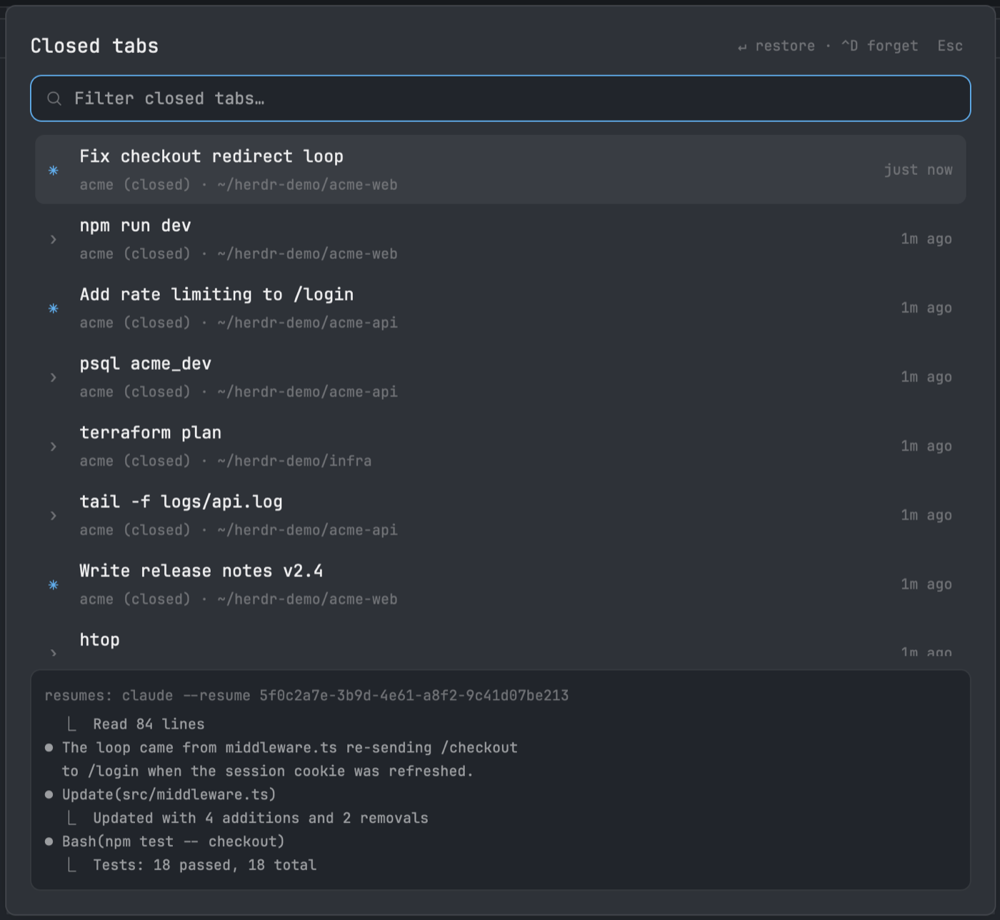

# Closed tabs

A popup that lists every tab you closed, newest first, so you can bring one back. Press ⌘⇧T and a 760px-wide panel drops from the top of the window: a filter field, one row per closed tab (its title, its space and folder, how long ago it closed) and, under the list, the last lines that tab's screen showed. A tab that ran a Claude Code session comes back with that session resumed (`claude --resume <id>`); a plain shell comes back as a new shell in the folder it was last in, in the same space.



## What you see

The popup is 760px wide, 80% of the window high, 40px from the top, horizontally centered (Herdr's popup frame). Inside, 18px padding, 10px gaps, background `popover`, base text 13px. Top to bottom:

1. **Header row.** "Closed tabs" at 15px semibold in `foreground` on the left. On the right, "↵ restore · ⌃D forget" at 11px in `dim` (8px right margin), then a small "Esc" button (11px, `dim`, 6×2px padding, 5px radius; on hover `hover` background and `foreground` text).
2. **Filter field.** 36px high, 9px radius, 1px `accent` border, `background` fill, 10px horizontal padding, 8px gap. A 15px magnifier icon in `dim` (the shipped `mods/workspace-chrome/search.svg`), then the text input at 12.8px in `foreground`, placeholder "Filter closed tabs…". It has the keyboard as soon as the popup opens.
3. **The list.** Height `min(400, rows × 48)` px, scrolls with a scrollbar. Each row: 4px side margin, 10×6px padding, 7px radius, 10px gap, items centered:
   - a 14px-wide marker: `✳` in `accent` if a Claude session was found for it, `›` in `dim` otherwise;
   - a two-line block: the terminal's title in `foreground` (or "Claude session" / "shell" when it has none), and below it at 11px in `dim`: `<space name> · <folder>`, the folder with the home folder shown as `~`. If the space no longer exists the name is the one it had, followed by " (closed)";
   - "open now" at 11px in `done` color, only on a session row whose title equals the title of an agent that's running right now;
   - on the right, at 11px in `dim`: "just now", "5m ago", "3h ago", "2d ago".
   The selected row and the hovered row have a `hover` background.
4. **Preview box.** Only when a row is selected. 170px high, 10px padding, 4px gap, 8px radius, `background` fill, 1px `border`, clips overflow. First line at 11px in `dim` says what Enter will do: "resumes: claude --resume <session id>", or "opens a shell in ~/folder", or, while sessions are still being looked up, "looking for its Claude session…". Below at 11px in `muted`: the last 10 non-blank lines of that terminal's final screen ("…" while loading, "(empty screen)" if none).

States in place of the list: "Looking through closed terminals…" while loading; "No closed tabs." when there are none (or none match the filter); "Couldn't list terminals: <error>" if `hc` failed.

## How it behaves

- **Open / close.** ⌘⇧T (`mod.open:closed-tabs`) opens it; pressing it again, Esc, or clicking "Esc" closes it. Restoring a row closes it too.
- **What counts as a closed tab.** A core terminal that is `finished` with reason `killed`, has no `parent` (sub-agents are skipped) and carries a `herdr.space` label, i.e. a terminal Herdr started for a tab and that was ended by closing its tab or pane. Programs that exited by themselves are not listed. At most 60, newest first by when they finished.
- **Claude sessions.** For each row the mod looks in `~/.claude/projects/<cwd with every non-alphanumeric char replaced by ->/` for `*.jsonl` files modified since the terminal started that contain `"aiTitle":"<the terminal's title>"` (Claude Code names its terminal after the session's AI title). If several match, it takes the one whose modification time is closest to when the tab closed. Rows first appear with `›`; markers switch to `✳` when the lookup finishes. After the lookup, only the most recently closed tab of each session is kept (one row per session).
- **Filter.** Typing filters case-insensitively on title, the `space / tab` label and the folder; the selection goes back to the first row.
- **Keys.** ↑/↓ move the selection (the list scrolls to keep it visible and its preview loads). Enter restores the selected row. ⌃D "forgets" the selected row: it disappears from the list for good. Esc closes.
- **Mouse.** Clicking a row selects it; clicking the selected row restores it. Rows highlight on hover.
- **Restore.**
  - If the tab's space still exists: `tab.new` in that space, in the terminal's last folder.
  - If not: `space.new` in that folder.
  - A session row runs `<shell> -lc "claude --resume <id>; exec <shell> -l"` so you're left in a login shell after Claude exits; `<shell>` is the closed terminal's `argv[0]` (normally `/bin/zsh`). A plain shell row passes no `argv` (the default shell).
  - The new tab gets the old tab's name if it had a real one (the part after " / " in the `where` label, unless it's just a number or "tab N").
  - The restored row is then forgotten, like ⌃D.
- Agent statuses (working, blocked, done, idle) aren't shown; closed terminals have none. The only live signal is "open now".
- Nothing animates.

## Built from

- **Files:** `mods/closed-tabs/main.js`, `mods/closed-tabs/mod.json`, and `keys.json` with one binding:
  ```json
  { "global": { "cmd-shift-t": "mod.open:closed-tabs" } }
  ```
- **mod.json:** `{"place":"none","title":"Closed tabs","overlay":{"kind":"popup","at":"top","offset":40,"width":760,"height":0.8}}`. No layout block; it's only ever an overlay opened by `mod.open`. Props: only `props().overlay` (for `closeOverlay`).
- **Imports:** `View, div, svg` from `gpui-kit`; `v_flex, h_flex, InputState, Input, ScrollHandle` from `gpui-base`; `spaces, agents, run, hc, exec, home, theme, props, closeOverlay, shared, setShared, checking` from `herdr`.
- **Loading (in `init`, inside `cx.spawn`):**
  1. `hc(["ls", "--all", "--json"])` → `.terminals`, filtered to `state === "finished" && reason === "killed" && !parent`.
  2. `hc(["get", address, "--json"])` for each, in parallel, for `argv`, `cwd`, `title`, `labels` (`herdr.space`, and `where` = "space name / tab name", which Herdr writes), `created_ms`, `finished_ms`. Keep those with a `herdr.space` label, sort by `finished_ms` descending, take 60.
  3. Render, then fetch the selected row's preview, then resolve sessions.
- **Session lookup:** one `exec("sh", ["-c", SCRIPT, "sh", projectDir, '"aiTitle":' + JSON.stringify(title), createdSeconds], {timeout: 15000})` per row, where SCRIPT `cd`s into the project dir, loops over `*.jsonl`, keeps files whose `stat -f %m` is ≥ the start time and that `grep -q -F` the needle, and prints `<mtime> <file>`. The session id is the file name without `.jsonl`.
- **Preview:** `hc(["read", address, "--lines", "40"])`, dropping blank lines, lines starting with `[hc]` and lines made only of `─`/`━`; keep the last 10. Fetched lazily per selected row and cached.
- **Forget list:** shared key `closed-tabs.hidden`, an array of terminal addresses, capped at the last 500 (`setShared`).
- **Commands:** `tab.new {space, folder, argv?, name?}`, `space.new {folder, argv?, tab?}`, and `closeOverlay(props().overlay)`.
- **Keyboard:** a focus handle tracked on the root with `on_key_down` for escape / up / down / ctrl-d; Enter comes from the input's `submit` event, typing from its `change` event. List scrolling uses `ScrollHandle.scroll_to_item(index)` on the list (each row is a direct child).
- **Art:** none of its own; it borrows `mods/workspace-chrome/search.svg`.

## Watch out

- **Focus.** The input must get focus in `init` and again ~600ms later (`cx.timer.after(600, …)`); the first focus can be lost while the popup is still opening.
- **`herdr-app check`.** Guard with `if (checking()) { this.items = []; return; }` before any `hc`/`exec`, or the check runs them.
- **The shell wraps everything.** Herdr starts tab commands as `/bin/zsh -lic '"$@"; exec "$0" -li' …`, so `argv[0]` is the user's shell, not the program. That's why restore uses `argv[0]` as the shell.
- **macOS only as written.** `stat -f %m` is BSD stat; on Linux use `stat -c %Y`. The key is `cmd-shift-t`; on Linux/Windows pick e.g. `ctrl-shift-t` (check it isn't already `tab.new` there).
- **Title matching is a heuristic.** A session is found only if the closed terminal's title equals the session's `aiTitle` exactly. Two sessions with the same title in the same folder: the one written closest to the close time wins. Sessions renamed after closing, or in folders that moved, aren't found and come back as plain shells.
- **"Forget" is per address.** The hidden list stores terminal addresses, not titles; finished terminals removed with `hc rm` drop out of the list on their own.
- The list is computed once per opening; closing more tabs while it's open doesn't update it.
- Local only: `hc` is called without `--on`, so tabs closed in spaces on other machines aren't listed.
- **Permissions for anyone installing it:** it runs programs (`hc ls/get/read`, `sh` with `stat` and `grep`) and reads files outside its folder (`~/.claude/projects/**/*.jsonl`, only to match titles). It makes no network requests.

## Done when

- `herdr-app check ~/.config/herdr-app/mods/closed-tabs` passes.
- Closing a shell tab, then pressing ⌘⇧T, shows it at the top with `›`, its space and `~`-shortened folder, "just now", and its last screen lines in the preview box.
- Closing a tab running Claude Code (after it has named the session) shows a `✳` row whose preview header reads `resumes: claude --resume <uuid>`; Enter opens a tab in the same space where that session continues.
- Enter on a shell row opens a new tab in the same space and folder; the row is gone next time the popup opens.
- Typing filters rows; ↑/↓ move the highlight and update the preview; ⌃D removes the row; Esc closes.
- A row whose space was closed shows "<name> (closed)" and restoring it makes a new space in that folder.
- With nothing closed, the popup says "No closed tabs."
